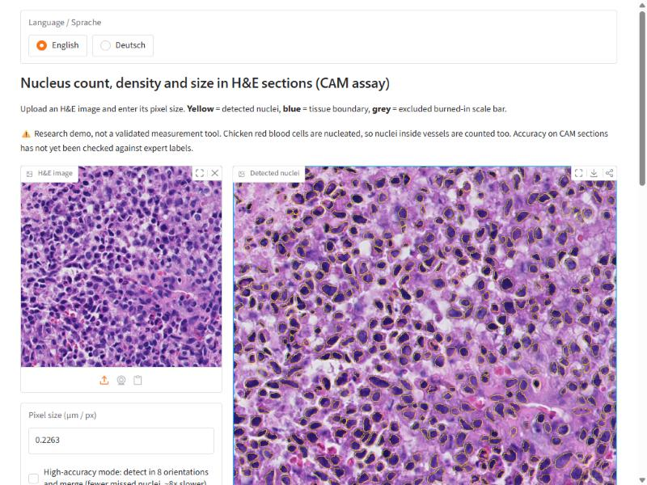

# cam-nuclei: Anzahl, Dichte und Größe von Zellkernen in H&E-Schnitten

[English](README.md) | **Deutsch**

Ein kleines, lokal laufendes Werkzeug für **Chorioallantoismembran-Assays (CAM-Assays)** und allgemein für H&E-Schnitte.
Sie geben ein Bild und dessen Pixelgröße ein; das Werkzeug liefert:

- die Gewebefläche;
- die Anzahl der Zellkerne;
- die Kerndichte pro mm² Gewebe;
- die Verteilung von Kerngröße und Kernform;
- eine lokale Dichtekarte;
- eine CSV-Datei mit den Messwerten jedes einzelnen Zellkerns.

Es gibt eine Weboberfläche (Englisch / Deutsch) und eine Kommandozeile für die Stapelverarbeitung.



> ⚠️ **Forschungswerkzeug, kein validiertes Messgerät.**
> Die Kernerkennung wurde auf großen öffentlichen Datensätzen mit Experten-Annotationen geprüft (siehe *Genauigkeit*).
> Auf CAM-Schnitten wurde sie bisher nur visuell und an wenigen manuell markierten Kernen überprüft.
> Lesen Sie die *Einschränkungen*, bevor Sie die Werte verwenden.

## Schnellstart

Python 3.10–3.12. Eine GPU ist optional.

```bash
git clone https://github.com/YuLiuPotato/cam-nuclei.git && cd cam-nuclei
python -m venv .venv
# Windows: .venv\Scripts\activate    Linux/macOS: source .venv/bin/activate
pip install -r requirements.txt
python app.py                     # danach http://127.0.0.1:7860 öffnen
```

Bild hochladen, Pixelgröße in µm/px eingeben und auf **Analysieren** klicken. Zwei öffentliche Beispielbilder sind enthalten.

Stapelverarbeitung über die Kommandozeile:

```bash
python cam_nuclei.py schnitt1.jpg schnitt2.jpg --um 0.6595 --out results
```

Pro Bild entstehen ein Überlagerungsbild und eine CSV-Datei je Zellkern, dazu eine `summary.json` für alle Bilder.

| Option | Bedeutung |
|---|---|
| `--tta` | Hochgenauigkeitsmodus |
| `--seed` | Seed-Schwelle von InstanSeg (Standard 0,3) |

Beim ersten Start wird das InstanSeg-Modell heruntergeladen, etwa 16 MB.

Rechenzeit für ein Bild mit 2880 × 2160 px:

| Hardware | Normaler Modus | Hochgenauigkeitsmodus |
|---|---|---|
| Laptop-GPU | 11–17 s | etwa 75 s |
| Nur CPU | etwa 100 s | etwa 8-mal länger |

Die CPU-Zeit wurde gemessen, während die CPU zusätzlich durch eine andere Aufgabe ausgelastet war.

## Ausgaben

| Ausgabe | Definition |
|---|---|
| Gewebefläche (mm²) | Fläche der Gewebemaske (siehe *Methode*) |
| Anzahl Zellkerne | Kerne, deren Mittelpunkt in der Gewebemaske liegt |
| Kerndichte | Anzahl Zellkerne / Gewebefläche |
| Kernfläche | Median, 10. und 90. Perzentil (µm²) |
| Äquivalentdurchmesser | Durchmesser eines Kreises mit derselben Fläche wie der Kern (µm) |
| Rundheit | 4π · Fläche / Umfang², von 0 bis 1 |
| Längliche Kerne | Anteil der Kerne, deren Längsachse mehr als doppelt so lang ist wie die Querachse (%) |
| Lokale Dichtekarte | Kerne pro mm² in Zellen von 100 µm; Zellen mit weniger als 50 % Gewebe sind grau |
| CSV je Zellkern | Position, Fläche, Äquivalentdurchmesser, Längs- und Querachse, Längenverhältnis, Rundheit, Solidität, mittlere optische Dichte des Hämatoxylins |

## Methode

1. **Ausschluss des Maßstabsbalkens.** Ein eingebrannter Maßstabsbalken (ein langer, dünner, rein weißer waagrechter Balken) und seine Beschriftung werden ausgeblendet. Bilder ohne solchen Balken sind nicht betroffen.
2. **Zellkerne.** [InstanSeg](https://github.com/instanseg/instanseg) `brightfield_nuclei` (Apache-2.0) liefert für jeden Kern eine eigene Instanzmaske.
   - Der Kontrast wird einmal für das ganze Bild normalisiert; danach wird das Bild in Kacheln verarbeitet.
   - Die Seed-Schwelle ist von 0,7 (Modellstandard) auf 0,3 gesenkt; siehe *Genauigkeit*.
   - Optionaler Hochgenauigkeitsmodus: Das Bild wird in 8 Orientierungen ausgewertet (Spiegelungen × 90°-Drehungen). Ein Kern, der in irgendeiner Orientierung gefunden wird, bleibt erhalten.
3. **Gewebemaske.** Ein Pixel zählt als Gewebe, wenn beides zutrifft:
   - es ist **gefärbt** (optische Dichte relativ zur *lokalen* Helligkeit des Objektträgers, was ungleichmäßige Beleuchtung ausgleicht) **oder strukturiert** (lokale Standardabweichung der optischen Dichte; lockeres CAM-Mesenchym ist blass, aber faserig, während Glas glatt ist);
   - im Umkreis von 35 µm liegen mindestens 2 erkannte Kerne. Das entfernt leeres Glas mit Kamerastreifen oder Staub.

   Löcher unter 2000 µm² zählen als Gewebe; Fragmente unter 5000 µm² werden verworfen.

## Genauigkeit

Die Parameter wurden auf den *Validierungs*-Splits von PanNuke und PUMA gewählt. Die folgenden Werte stammen aus zurückgehaltenen *Test*-Splits, getrennt nach Patient bzw. Schnitt. NuInsSeg (31 Organe von Mensch und Maus) wurde für keine Entscheidung verwendet.

Kennzahl ist der Punkt-F1-Wert: Ein vorhergesagter Kern gilt als richtig, wenn er höchstens 4 µm von einem annotierten Kern entfernt liegt. Das Zählverhältnis ist vorhergesagte / annotierte Kerne; 1,00 bedeutet keine systematische Über- oder Unterzählung.

| Einstellung | PanNuke | PUMA | NuInsSeg (nie verwendet) |
|---|---|---|---|
| InstanSeg, Modellstandard | F1 0,769, Verhältnis 0,75 | F1 0,915, Verhältnis 0,92 | F1 0,881, Verhältnis 0,84 |
| **Dieses Werkzeug (Seed-Schwelle 0,3)** | **F1 0,794, Verhältnis 0,84** | **F1 0,925, Verhältnis 0,98** | **F1 0,898, Verhältnis 0,90** |
| Hochgenauigkeitsmodus (gemessen mit Seed 0,7) | F1 0,795, Verhältnis 0,88 | F1 0,921, Verhältnis 0,99 | F1 0,905, Verhältnis 0,96 |

Mit seinen Standardeinstellungen übersieht InstanSeg etwa 10–25 % der Kerne. Beide Änderungen verringern vor allem diese Fehler.

Zum Vergleich: CNN- und ViT-Segmentierungsmodelle, die wir auf mehreren öffentlichen Datensätzen trainiert haben, erreichten auf NuInsSeg F1 0,81. Sie können außerdem keine Kerngröße messen, und ihre Gewichte erben nicht-kommerzielle Lizenzen. InstanSeg wird daher ohne Nachtraining verwendet.

## Einschränkungen

- **Auf CAM nicht mit Experten-Annotationen validiert.** An wenigen manuell markierten CAM-Kernen zählte das Werkzeug etwas *mehr* Kerne als markiert, also umgekehrt zu den öffentlichen Datensätzen. Verwenden Sie **für alle Bilder einer Studie dieselben Einstellungen**, damit sich systematische Abweichungen zwischen den Gruppen aufheben.
- **Erythrozyten des Huhns sind kernhaltig.** Kerne in Gefäßen oder Blutungen werden als Zellen gezählt. Diese Verzerrung wächst mit der Vaskularisierung.
- **Die Gewebemaske kann am Gewebsrand etwas Glas enthalten**, besonders bei starken Kamerastreifen. Das senkt die Dichte leicht.
- **Unscharfe Bereiche** verlieren Kerne.
- **Andere eingebrannte Beschriftungen als ein weißer Maßstabsbalken** werden nicht entfernt.
- **Alle Ergebnisse hängen von der eingegebenen Pixelgröße ab.**

## Mögliche Erweiterungen

Weitere CAM-Kennwerte, die keine Gefäßsegmentierung brauchen:
- CAM-Dicke;
- Anteil lockeren Gewebes (Ödem);
- Hämatoxylin-/Eosin-Zusammensetzung;
- Heterogenität der lokalen Dichte.

Für die Klassifikation von Zelltypen, zum Beispiel Erythrozyten gegenüber Gewebezellen oder Entzündungszellen, braucht man von Experten annotierte CAM-Daten.

## Lizenz und Danksagung

- **Code:** Apache-Lizenz 2.0 (siehe `LICENSE`).
- **Kernmodell:** InstanSeg, Apache-2.0. Die Gewichte werden zur Laufzeit heruntergeladen und hier nicht weiterverteilt. Bitte zitieren Sie Goldsborough et al., *InstanSeg*, arXiv:2408.15954 (2024).
- **Beispielbilder:** PUMA-Challenge-Datensatz (Zenodo 15050523), CC0.

Details in `NOTICE`.
