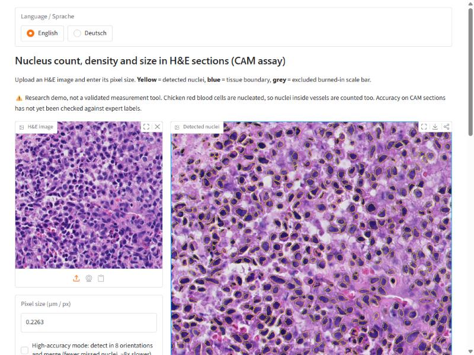

# cam-nuclei: nucleus count, density and size in H&E sections

**English** | [Deutsch](README.de.md)

A small, local tool for **chick chorioallantoic membrane (CAM) assays**, and for H&E sections in general.
You give it an image and its pixel size; it returns:

- the tissue area;
- the number of nuclei;
- the nucleus density per mm² of tissue;
- the nucleus size and shape distribution;
- a local density map;
- a CSV file with the measurements of every single nucleus.

There is a web interface (English / Deutsch) and a command line for batch processing.



> ⚠️ **Research tool, not a validated measurement device.**
> Nucleus detection was benchmarked on large public datasets with expert annotations (see *Accuracy*).
> On CAM sections it has so far only been checked visually and on a small number of manually marked nuclei.
> See *Limitations* before using the numbers.

## Quick start

Python 3.10–3.12. A GPU is optional.

```bash
git clone https://github.com/YuLiuPotato/cam-nuclei.git && cd cam-nuclei
python -m venv .venv
# Windows: .venv\Scripts\activate    Linux/macOS: source .venv/bin/activate
pip install -r requirements.txt
python app.py                     # then open http://127.0.0.1:7860
```

Upload an image, enter the pixel size in µm/px, and click **Analyse**. Two public example images are included.

Batch processing from the command line:

```bash
python cam_nuclei.py slide1.jpg slide2.jpg --um 0.6595 --out results
```

This writes, per image, an overlay image and a per-nucleus CSV, plus a `summary.json` for all images.

| Option | Meaning |
|---|---|
| `--tta` | High-accuracy mode |
| `--seed` | InstanSeg seed threshold (default 0.3) |

The first run downloads the InstanSeg model, about 16 MB.

Processing time for a 2880 × 2160 px image:

| Hardware | Normal mode | High-accuracy mode |
|---|---|---|
| Laptop GPU | 11–17 s | about 75 s |
| CPU only | about 100 s | about 8× longer |

The CPU time was measured while the CPU was also busy with another job.

## Outputs

| Output | Definition |
|---|---|
| Tissue area (mm²) | Area of the tissue mask (see *Method*) |
| Nuclei count | Nuclei whose centre lies inside the tissue mask |
| Nucleus density | Nuclei count / tissue area |
| Nucleus area | Median, 10th and 90th percentile (µm²) |
| Equivalent diameter | Diameter of the circle with the same area as the nucleus (µm) |
| Circularity | 4π · area / perimeter², from 0 to 1 |
| Elongated nuclei | Share of nuclei whose long axis is more than twice the short axis (%) |
| Local density map | Nuclei per mm² in 100 µm cells; cells that are less than 50 % tissue are grey |
| Per-nucleus CSV | Position, area, equivalent diameter, major and minor axis, elongation, circularity, solidity, mean haematoxylin optical density |

## Method

1. **Scale bar exclusion.** A burned-in scale bar (a long, thin, pure-white horizontal bar) and its text labels are masked out. Images without such a bar are not affected.
2. **Nuclei.** [InstanSeg](https://github.com/instanseg/instanseg) `brightfield_nuclei` (Apache-2.0) gives one instance mask per nucleus.
   - Contrast is normalised once for the whole image, then the image is processed in tiles.
   - The seed threshold is lowered from the model default 0.7 to 0.3; see *Accuracy*.
   - Optional high-accuracy mode: the image is analysed in 8 orientations (flips × 90° rotations). A nucleus found in any orientation is kept.
3. **Tissue mask.** A pixel counts as tissue when both of these hold:
   - it is **stained** (optical density relative to the *local* glass brightness, which compensates for uneven illumination) **or textured** (local standard deviation of optical density; loose CAM mesenchyme is pale but fibrous, while glass is flat);
   - at least 2 detected nuclei lie within 35 µm, which removes empty glass that shows camera banding or dust.

   Holes smaller than 2000 µm² count as tissue; fragments smaller than 5000 µm² are dropped.

## Accuracy

The parameters were chosen on the *validation* splits of PanNuke and PUMA. The numbers below are measured on held-out *test* splits, split by patient or slide. NuInsSeg (31 human and mouse organs) was never used for any choice.

The metric is the point F1 score: a predicted nucleus counts as correct when it lies within 4 µm of an annotated one. The count ratio is predicted / annotated nuclei; 1.00 means no systematic over- or undercounting.

| Setting | PanNuke | PUMA | NuInsSeg (never used) |
|---|---|---|---|
| InstanSeg, model defaults | F1 0.769, ratio 0.75 | F1 0.915, ratio 0.92 | F1 0.881, ratio 0.84 |
| **This tool (seed threshold 0.3)** | **F1 0.794, ratio 0.84** | **F1 0.925, ratio 0.98** | **F1 0.898, ratio 0.90** |
| High-accuracy mode (measured with seed 0.7) | F1 0.795, ratio 0.88 | F1 0.921, ratio 0.99 | F1 0.905, ratio 0.96 |

With its default settings, InstanSeg misses roughly 10–25 % of nuclei. Both changes mostly reduce these misses.

For comparison, CNN and ViT segmentation models that we trained on several public datasets reached F1 0.81 on NuInsSeg. They also cannot measure nucleus size, and their weights inherit non-commercial licences. InstanSeg is therefore used without retraining.

## Limitations

- **Not validated on CAM with expert labels.** On a small set of manually marked CAM nuclei, the tool counted somewhat *more* nuclei than were marked, the opposite of the public datasets. Use the **same settings for all images of a study**, so that systematic biases cancel between groups.
- **Chicken red blood cells are nucleated.** Nuclei inside vessels or haemorrhages are counted as cells. This bias grows with vascularity.
- **The tissue mask can include some glass at tissue edges**, especially with strong camera banding. This slightly lowers the density.
- **Out-of-focus regions** lose nuclei.
- **Burned-in annotations other than a white scale bar** are not removed.
- **All results depend on the pixel size you enter.**

## Possible extensions

Other CAM read-outs that need no vessel segmentation:
- CAM thickness;
- loose-tissue (oedema) fraction;
- haematoxylin / eosin composition;
- heterogeneity of the local density.

Classifying cell types, for example red blood cells versus tissue cells or inflammatory cells, needs expert-annotated CAM data.

## Licence and credits

- **Code:** Apache License 2.0 (see `LICENSE`).
- **Nucleus model:** InstanSeg, Apache-2.0. Its weights are downloaded at runtime and not redistributed here. Please cite Goldsborough et al., *InstanSeg*, arXiv:2408.15954 (2024).
- **Example images:** PUMA challenge dataset (Zenodo 15050523), CC0.

See `NOTICE` for details.
